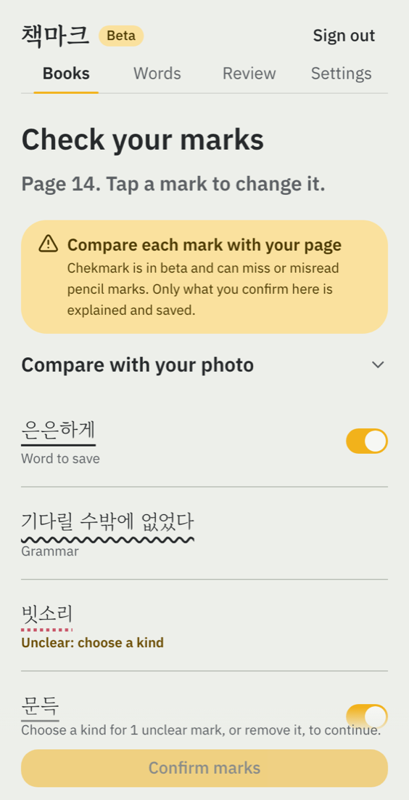
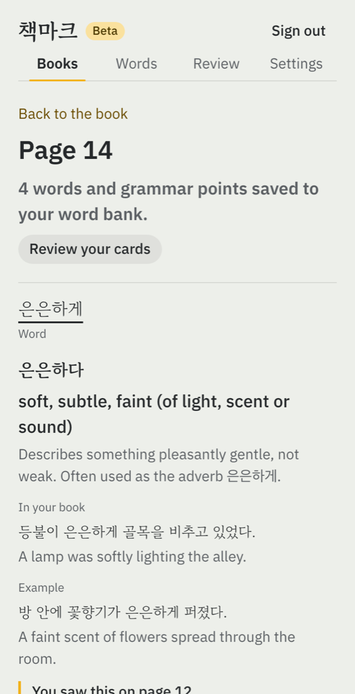
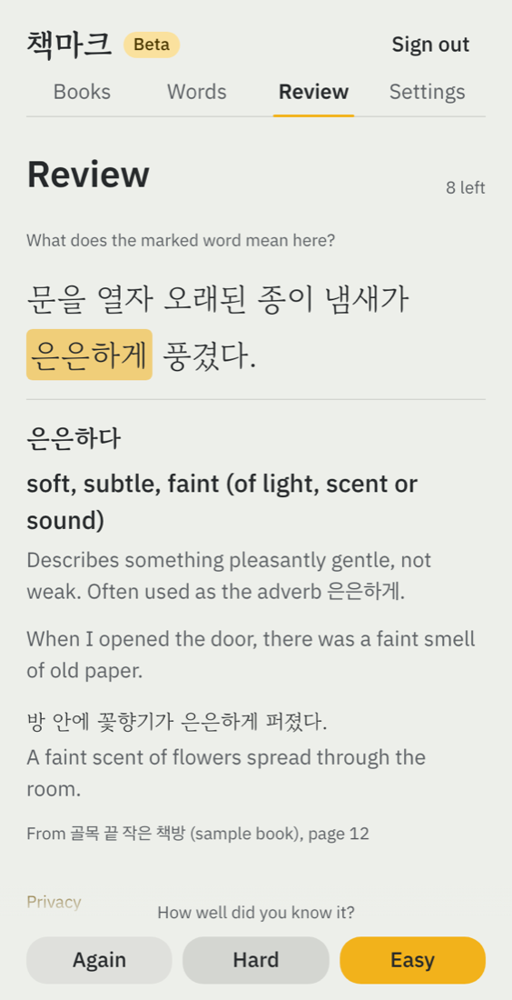
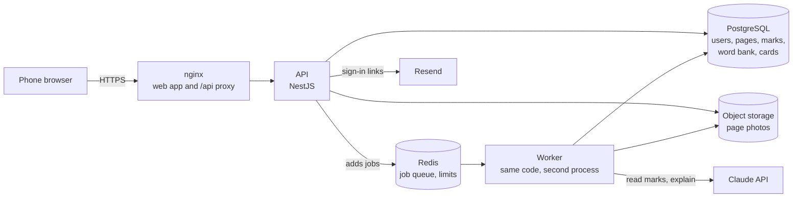

# Chekmark (책마크)

Read a real Korean book, mark it with a pencil, and your marks become your study material.

Chekmark is a phone-first web app. You underline words, draw a wavy line under grammar, or underline a whole sentence, then take a photo of the page. The app reads your marks with Claude, lets you check them, explains each one in English, and turns the words and grammar into flashcards built from sentences in your own book.

**[Open the app](https://chekmark.app)** and choose *Try the demo*: no email needed, sample pages, deleted after 24 hours.

| Check the marks | Read the results | Review |
|---|---|---|
|  |  |  |

The screenshots show the demo's invented sample book.

**Status:** beta. Mark reading is about 65–75% accurate on the first test pages ([results](docs/stage-0-results.md)), so every page goes through a Mark check before anything is saved.

## Why I built it

I was reading the Korean edition of *Atomic Habits* by James Clear to practise my Korean. I'm not that good at Korean yet, so a single page could have 10–20 new words and a few grammar points. To actually learn something, I translated each word, checked examples in real sentences and studied the grammar, which took me about 40 minutes a page. At that pace a 400-page book would take around 270 hours, which didn't make sense. So I decided to make this app, so that people can read the books they're interested in, in the language they're learning.

**Who it is for.** A small group of people who like learning a language by reading paper books with a pencil in hand. It also works for e-books: mark the page on a tablet, then take a screenshot or a photo of it.

**Why I built it before accuracy reached the target.** The first test scored about 75% against a 90% target, but the test set was small (7 pages) and I wanted to use the app myself. On my own pages I usually see 95–100%; grammar books and unusual layouts that other people sent me do worse. Those figures for my own pages are my impression, not a measured result, and the Mark check is there because a page can still go wrong.

**What changed for me.** A page that took 30–40 minutes now takes about 5–10 (my own estimate). The notes are already there, so I spend the time memorising new words and grammar instead of googling everything, choosing websites and working out which use of a word fits the sentence.

## How it works

1. **Sign in** with a one-time email link. No password.
2. **Add a page:** the page number and one photo. The browser shrinks the photo before upload.
3. **Mark check:** the app lists the marks it found. You fix the kind or the text, remove wrong ones, add missed ones, and confirm.
4. **Results:** the meaning in context, a usage note, your sentence with a translation, and an example. A word you have met before shows where you saw it.
5. **Review:** flashcards with your own sentence on the front, scheduled with an SM-2 style algorithm.

## What it is built with

| Part | Technology |
|---|---|
| API and worker | NestJS 12, TypeScript, one codebase started as two processes |
| Database | PostgreSQL with Prisma 7 |
| Job queue | BullMQ on Redis: retries, a stuck-page check, daily clean-up |
| Photos | S3-compatible storage (SeaweedFS locally, Cloudflare R2 in production) |
| AI | Claude (Haiku) with structured output checked against a schema |
| Web app | React 19, Vite, React Router, the [Astryx](https://github.com/meta/astryx) design system with a custom theme |
| Tests | Vitest, Testcontainers (real PostgreSQL, Redis, storage and mail server), Playwright end to end |
| Running it | Docker images for the API/worker and the web server (nginx) |

## Architecture



Reading a page takes many seconds, so the API only saves the photo and queues a job. The worker does the slow part, and the phone asks for the page's status. Page status lives in PostgreSQL, so losing Redis data delays pages but does not lose them: a check every five minutes queues stuck pages again.

## Hard problems

- **A double tap must not start two jobs.** Every page moves through a small state machine with one conditional update, so of two simultaneous requests exactly one wins. [`page-status.ts`](apps/api/src/jobs/page-status.ts)
- **Jobs can run twice.** Explanations are saved in one transaction that skips marks already saved, so a retry adds nothing twice. [`save-results.ts`](apps/api/src/wordbank/save-results.ts)
- **Two pages with the same new word.** Explained at the same moment, they collided on the word's row, and the retry made a duplicate card. Saving now takes a PostgreSQL advisory lock per reader and reuses a meaning the model had not seen. The test holds both AI calls open to reproduce the race every time. [`explanation.int-spec.ts`](apps/api/test/explanation.int-spec.ts)
- **AI answers cannot be trusted.** Every answer is checked against a schema built from that page's marks and retried once if it is wrong, and the reader confirms the marks before anything is explained. [`explanation.schema.ts`](apps/api/src/explanation/explanation.schema.ts)
- **AI costs money.** Each call is logged with its cost; a daily page limit and a monthly budget pause new work. Demo visitors are answered from saved answers at the one place all AI requests pass. [`demo-routing-ai-client.ts`](apps/api/src/ai/demo-routing-ai-client.ts)
- **The host blocked email.** SMTP timed out on Railway, so sign-in email moved to Resend's HTTPS API. [`mailer.ts`](apps/api/src/accounts/mailer.ts)

Every decision, with what it costs if it was wrong, is in [`docs/stage-1-decisions.md`](docs/stage-1-decisions.md).

## Run it on your computer

You need Node 24, Docker, and pnpm through corepack.

```bash
corepack pnpm install
cp .env.example .env        # then put your Anthropic API key in .env
docker compose --profile app up -d --build
```

Open http://localhost:8080. Enter any email address: with no email service set up, the sign-in screen shows the link itself.

To try it without an API key, start it with the scripted fake AI:

```bash
AI_PROVIDER=fake docker compose --profile app up -d --build
```

## Develop

```bash
docker compose up -d                          # PostgreSQL, Redis and photo storage
cd apps/api && corepack pnpm db:deploy        # create the tables
corepack pnpm start:dev                       # API on :3000
corepack pnpm start:worker                    # worker, in a second terminal
cd ../web && corepack pnpm dev                # web app on :5173
```

## Test

```bash
cd apps/api && corepack pnpm test             # unit tests
corepack pnpm test:int                        # integration tests (needs Docker)
cd ../web && corepack pnpm test               # web app tests
cd ../.. && corepack pnpm e2e                 # the whole journey, against the Docker stack started with AI_PROVIDER=fake
```

## Deploy

See [docs/deployment.md](docs/deployment.md) for Railway, Cloudflare R2, email and the settings that matter in production.

## Privacy

Photos are private to their reader and deleted after 30 days. Only the marked text and its sentence are kept, never the full page. Readers can delete a photo or their whole account at any time. The app's privacy page (`/privacy`) says this in plain words.

## How AI was used to build it

The code was written with Claude Code, and the commits say so. The plans, the decisions and the mark-reading test results are kept in [`docs/`](docs).

## Contact

Daulet Suienish: [GitHub](https://github.com/suyenish), [LinkedIn](https://www.linkedin.com/in/suienish/), [dauletsuyenish2308@gmail.com](mailto:dauletsuyenish2308@gmail.com)
